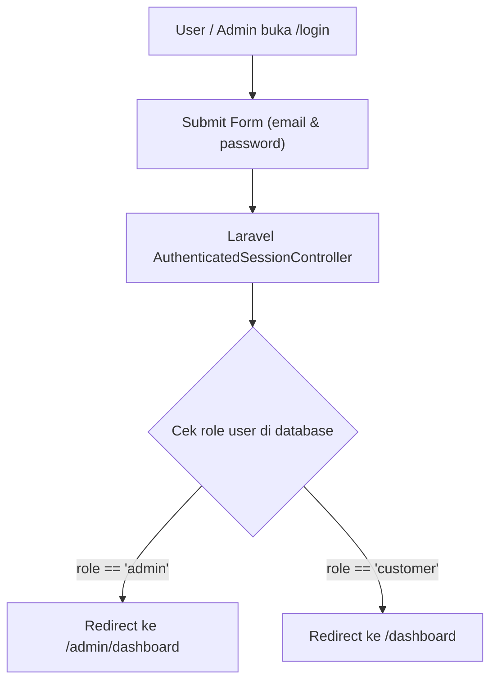

# 01 - Arsitektur & Tech Stack Platform

Dokumen ini menjelaskan fondasi arsitektur sistem, struktur folder, pola autentikasi satu pintu, serta konfigurasi deployment platform Undangan Digital.

---

## 1. Spesifikasi Tech Stack

| Layer | Teknologi | Catatan & Versi |
|---|---|---|
| **Backend Framework** | Laravel 11.x | PHP 8.2+, MVC pattern, Eloquent ORM |
| **Fullstack Bridge** | Inertia Laravel adapter 1.x + Vue adapter 3.x | Menghubungkan Laravel & Vue untuk page rendering |
| **Frontend Framework** | Vue 3 (Composition API) | `<script setup lang="ts">`, Strict Typing |
| **CSS & Styling** | Tailwind CSS v3.4 | Utilitas styling modern, kustom animasi, glassmorphism |
| **Database** | PostgreSQL 16 | Relasi terindeks, JSONB support untuk `design_json` |
| **Bundler & Compiler** | Vite 6.x + TypeScript | Build frontend assets dan validasi template Vue |
| **Container & Hosting** | Docker + Railway | Multi-stage build (Node build -> PHP-FPM + Nginx) |

---

## 2. Arsitektur Autentikasi Satu Pintu (Unified Auth)

Platform ini menggunakan **Satu Pintu Masuk Login** untuk semua level akun guna mencegah kebingungan pengguna:



### Aturan Baku Autentikasi:
1. **Rute Login Utama**: `/login` (Menangani otentikasi Admin dan User biasa sekaligus).
2. **Rute `/admin/login`**: Disediakan sebagai shortcut/alias yang me-redirect ke `/login`.
3. **Penyimpanan Role**: Disimpan di kolom `role` pada tabel `users`; implementasi menggunakan nilai `'admin'` dan `'customer'`.
4. **Middleware Proteksi**:
   - `auth`: Melindungi rute pengguna umum (`/dashboard`, `/invitations/*`, `/guests/*`, `/billing/*`).
   - `role:admin` / Middleware Admin: Melindungi seluruh rute operasional admin (`/admin/*`).

---

## 3. Struktur Direktori Proyek

```
UndanganDigital/
├── app/
│   ├── Http/
│   │   ├── Controllers/
│   │   │   ├── Admin/             # Controller khusus Admin (Dashboard, Templates, Users, Orders)
│   │   │   ├── Auth/              # Controller login, registrasi, logout satu pintu
│   │   │   ├── InvitationController.php   # Manajemen CRUD & publikasi undangan
│   │   │   ├── GuestController.php        # Manajemen tamu & link WhatsApp
│   │   │   ├── OrderController.php        # Checkout & Simulasi pembayaran
│   │   │   └── PublicInvitationController.php # Render undangan publik (/i/{slug})
│   │   └── Middleware/            # Autentikasi & proteksi role
│   └── Models/                    # Eloquent Models (User, Invitation, InvitationDesign, dsb)
├── database/
│   ├── migrations/                # Skema database
│   └── seeders/                   # Seeder akun admin, template dasar, dan paket harga
├── docs/                          # Master dokumentasi arsitektur & panduan AI (Folder Ini)
├── resources/
│   ├── css/                       # app.css (Tailwind directivies & custom classes)
│   └── js/
│       ├── components/            # Komponen global (ToastContainer, ConfirmModal)
│       ├── composables/           # Global composables (useToast, useConfirm)
│       ├── layouts/               # AppLayout.vue (Navbar, Sidebar, Toast/Modal mount)
│       └── pages/                 # Inertia Vue Pages:
│           ├── Admin/             # Tampilan panel admin
│           ├── Billing/           # Halaman paket & pembayaran
│           ├── Dashboard/         # Dashboard utama user
│           ├── Editor/            # Visual Interactive Editor (/invitations/{id}/editor)
│           ├── Guests/            # Buku Tamu & RSVP tracker
│           ├── Public/            # InvitationView.vue (Undangan Digital Publik)
│           └── Welcome.vue        # Landing page
├── routes/
│   ├── web.php                    # Seluruh rute Inertia & halaman aplikasi
│   └── api.php                    # Endpoint API AJAX (autosave editor, upload media, simulate pay)
├── docker-entrypoint.sh           # Script startup kontainer Railway
├── Dockerfile                     # Konfigurasi containerization multi-stage
└── vite.config.js                 # Konfigurasi build Vite & path aliases (@/ -> resources/js/)
```

---

## 4. Alur Deployment & Siklus Hidup Container

Deployment dilakukan secara otomatis menggunakan Git Push ke repository GitHub yang terhubung dengan **Railway**:

1. **Stage 1 (Vite Asset Builder)**:
   - Menggunakan Node 20.
   - Menjalankan `npm install` dan `npm run build` untuk memproduksi aset bundle di `public/build/`.
2. **Stage 2 (PHP-FPM + Nginx Runtime)**:
   - Menggunakan PHP 8.2-FPM di atas Alpine/Debian dengan Nginx.
   - Menyalin source code dan hasil build aset dari Stage 1.
   - Menginstal ekstensi database `pdo_pgsql`, `pdo_mysql`, `gd`, `zip`, dsb.
3. **Startup Script (`docker-entrypoint.sh`)**:
   - Menjalankan migrasi database otomatis: `php artisan migrate --force`.
   - Menjalankan seeder idempoten untuk paket dan template. Akun demo hanya dibuat pada environment `local`/`testing`.
   - Pada produksi, atur `ADMIN_EMAIL` dan `ADMIN_PASSWORD` untuk membuat atau merotasi akun admin saat seeder berjalan. Jangan memakai kredensial demo.
   - Melakukan `php artisan storage:link` untuk penyimpanan file foto, audio, dan QRIS.
   - Mengoptimalkan cache: `php artisan config:cache`, `route:cache`, `view:cache`.
   - Menjalankan proses Nginx dan PHP-FPM di latar belakang.
