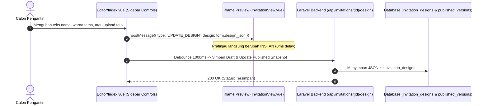

# 02 - Sistem Tema, Template & Kontrak Skema Desain

Dokumen ini adalah **panduan paling penting** bagi siapapun atau asisten AI manapun yang ingin memodifikasi tampilan, menambahkan tema baru, atau memperbarui panel editor.

> ⚠️ **ATURAN MUTLAK TEMA & DESAIN**:
> 1. **JANGAN PERNAH** menghapus atau mengganti nama key yang ada di dalam skema `design_json`. Properti baru **HARUS BERSIFAT ADITIF** (hanya menambahkan properti baru dengan fallback default).
> 2. Semua perubahan di editor harus selalu sinkron secara real-time ke iframe pratinjau menggunakan protokol `postMessage` yang sudah terpasang.
> 3. Semua template baru wajib membaca variabel warna CSS (`--primary-color`, dsb) atau reactive props dari objek `design_json`.

---

## 1. Arsitektur Komponen Tema & Editor

Sistem penyajian undangan digital terbagi menjadi dua sisi yang berkomunikasi secara langsung:



---

## 2. Kontrak Resmi JSON Skema (`design_json`)

Setiap data undangan disimpan di tabel `invitation_designs` pada kolom `design_json`. Berikut struktur lengkap dan wajib:

```json
{
  "theme": {
    "palette": "gold",
    "primaryColor": "#D4AF37",
    "secondaryColor": "#F3E5AB",
    "backgroundColor": "#171513",
    "cardColor": "#24201D",
    "fontHeading": "font-serif",
    "fontBody": "font-sans"
  },
  "cover": {
    "headline": "Dimas & Anisa",
    "subtitle": "The Wedding Celebration",
    "weddingDate": "2026-12-28",
    "coverPhoto": "https://images.unsplash.com/photo-1519741497674-611481863552?auto=format&fit=crop&w=1200&q=80",
    "musicUrl": "/audio/default-wedding.mp3"
  },
  "couple": {
    "groomName": "Dimas Prasetyo, S.Kom",
    "groomNickname": "Dimas",
    "groomParents": "Putra pertama dari Bpk. Bambang Prasetyo & Ibu Sri Wahyuni",
    "groomInstagram": "dimasprasetyo",
    "groomPhoto": "https://images.unsplash.com/photo-1507003211169-0a1dd7228f2d?auto=format&fit=crop&w=600&q=80",
    "brideName": "Anisa Rahmawati, S.E",
    "brideNickname": "Anisa",
    "brideParents": "Putri kedua dari Bpk. H. Rahmat Hidayat & Ibu Hj. Siti Nurhaliza",
    "brideInstagram": "anisarahma",
    "bridePhoto": "https://images.unsplash.com/photo-1494790108377-be9c29b29330?auto=format&fit=crop&w=600&q=80"
  },
  "quote": {
    "text": "Dan di antara tanda-tanda kebesaran-Nya ialah Dia menciptakan pasangan-pasangan untukmu dari jenismu sendiri...",
    "source": "QS. Ar-Rum: 21"
  },
  "gallery": [
    "https://images.unsplash.com/photo-1519741497674-611481863552?auto=format&fit=crop&w=800&q=80",
    "https://images.unsplash.com/photo-1583939003579-730e3918a45a?auto=format&fit=crop&w=800&q=80",
    "https://images.unsplash.com/photo-1511285560929-80b456fea0bc?auto=format&fit=crop&w=800&q=80",
    "https://images.unsplash.com/photo-1520854221256-17451cc331bf?auto=format&fit=crop&w=800&q=80"
  ],
  "gifts": {
    "accounts": [
      {
        "bank": "BCA",
        "number": "8830192831",
        "holder": "Dimas Prasetyo",
        "qrisUrl": "/storage/qris/sample.png"
      }
    ],
    "address": "Jl. Mawar No. 12, Kebayoran Baru, Jakarta Selatan (Kode Pos: 12130)"
  },
  "features": {
    "countdown": true,
    "rsvp": true,
    "comments": true,
    "gifts": true,
    "gallery": true,
    "stories": true,
    "music": true
  }
}
```

---

## 3. Sistem Palet Warna Preset

Di dalam editor (`Editor/Index.vue`), pengguna dapat memilih dari 6 palet warna mewah standar:

1. **👑 Royal Gold (`gold`)**:
   - `primaryColor`: `#D4AF37`
   - `secondaryColor`: `#F3E5AB`
   - Karakter: Elegan, nuansa emas kerajaan, mewah.
2. **🌸 Rose Gold (`rose`)**:
   - `primaryColor`: `#E0A9A5`
   - `secondaryColor`: `#FDE8E7`
   - Karakter: Romantis, modern, feminin lembut.
3. **🌿 Emerald Jade (`emerald`)**:
   - `primaryColor`: `#10B981`
   - `secondaryColor`: `#A7F3D0`
   - Karakter: Sejuk, nuansa alam taman, botani.
4. **🏺 Terracotta Warm (`terracotta`)**:
   - `primaryColor`: `#C25E43`
   - `secondaryColor`: `#F8D5C8`
   - Karakter: Hangat, bohemian, rustik estetik.
5. **💎 Sapphire Navy (`sapphire`)**:
   - `primaryColor`: `#38BDF8`
   - `secondaryColor`: `#BAE6FD`
   - Karakter: Klasik berwibawa, maritim, modern royal.
6. **🍷 Burgundy Wine (`burgundy`)**:
   - `primaryColor`: `#F43F5E`
   - `secondaryColor`: `#FECDD3`
   - Karakter: Berani, anggun, dramatis romantis.

> **Kustom Warna Bebas**: Di samping 6 preset di atas, calon pengantin tetap bisa memilih warna hex bebas (`<input type="color">`) yang langsung memperbarui `primaryColor` dan `secondaryColor`.

---

## 4. Mekanisme Komunikasi Real-Time `postMessage`

Agar pratinjau mobile di sisi kanan tidak reload (yang menyebabkan flicker/loading lama):

### Di Sisi Pengirim (`resources/js/pages/Editor/Index.vue`):
```typescript
const syncPreviewInstantly = () => {
    if (previewIframeRef.value && previewIframeRef.value.contentWindow) {
        previewIframeRef.value.contentWindow.postMessage({
            type: 'UPDATE_DESIGN',
            design: JSON.parse(JSON.stringify(designForm.design_json))
        }, '*');
    }
};

// Dipanggil di watcher setiap kali form berubah:
watch(() => designForm.design_json, () => {
    syncPreviewInstantly();
    triggerDebouncedSave();
}, { deep: true });
```

### Di Sisi Penerima (`resources/js/pages/Public/InvitationView.vue`):
```typescript
onMounted(() => {
    window.addEventListener('message', (event) => {
        if (event.data && event.data.type === 'UPDATE_DESIGN') {
            liveDesign.value = event.data.design;
        }
    });
});
```

---

## 5. Panduan Menambahkan Tema / Template Baru

Jika di masa depan Anda ingin meminta AI atau developer lain membuat variasi layout/tema baru:

1. **JANGAN MEROMBAK SKEMA**:
   Gunakan properti yang sudah ada di `design_json`. Jika butuh variasi layout (misal layout minimalis vs kartu bertingkat), tambahkan properti baru di dalam `theme`:
   ```json
   "theme": {
     "layoutVariant": "minimalist" // opsi: 'classic-card', 'modern-split', 'minimalist'
   }
   ```
2. **Gunakan Computed Properties**:
   Di komponen view undangan, selalu gunakan fallback:
   ```typescript
   const layout = computed(() => liveDesign.value?.theme?.layoutVariant || 'classic-card');
   ```
3. **Daftarkan di Seeder Database**:
   Tambahkan template baru di `database/seeders/TemplateSeeder.php` dengan field `slug`, `name`, `category`, dan snapshot `default_design_json`.
